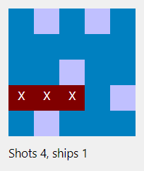

# Battleship on forms

The [console Battleship](../battleship/)'s engine, played on forms, written the way a VB6 developer would write it:
- `Sub Main` shows a setup dialog `vbModal`, asking for your name and the board size;
- the board loads its grid of Labels with `Load` at run time, positions each in twips, and sizes the form to fit;
- the board holds `Private WithEvents mGame As Game`, and the game raises `Result` for each shot, which the form paints;
- `MouseDown` on a cell fires at it;
- a win, or running out of shots, asks `MsgBox "Play again?", vbYesNo`. No unloads the board with `Unload Me`, and the
  run ends with the last form.

## Files

| File | What it is |
|---|---|
| `BattleshipForms.vbp` | The project. It starts at `Sub Main`. |
| `modMain.bas` | `Sub Main`, and what the setup dialog asked for. |
| `frmSetup.frm` | The setup dialog: a name, and 5 x 5, 7 x 7 or 10 x 10. OK hides it, so Main can read it. Cancel or the close box unloads it, and the run ends there. |
| `frmBoard.frm` | The board. |
| `Game.cls`, `Grid.cls`, `Ship.cls` | The console demo's engine. The grid takes any size, and the fleet is placed at random, two ships on 5 x 5 and the classic five on 10 x 10. |

You get half as many shots as the board has cells. A miss is pale blue and a hit red, a ship sunk turns dark red, and
when the shots run out the ships you missed are shown in grey.

## Running it

- **In HexIDE:** open `BattleshipForms.vbp` and press F5.
- **In VB6:** `VB6.EXE /make BattleshipForms.vbp`. It builds cleanly, native and p-code.

## What it took

Written the natural way, it ran into four things HexIDE got wrong, each measured on vb6.exe and fixed:
- **`Trim$(txtName.Text)`,** in the setup dialog, stopped the run: a call written with a `$`. The call form is fixed
  here, from a measurement of which library functions have a `$` form and what the `$` changes. The rest of the
  type-character work is #742.
- **`lblCell(i).Move ...`,** laying out the grid, stopped the run: Move wasn't implemented. Fixed here.
- **`Width - ScaleWidth`,** fitting the form to the grid, stopped the run: a form's ScaleWidth and ScaleHeight couldn't
  be read. Fixed here for the default ScaleMode. The rest of the form's coordinate system is #990.
- **`gSize * gSize \ 2`** gave a 5 x 5 board 10 shots instead of 12, with no error, because every operator had a
  precedence level of its own. That was fixed on its own, in #1074, since it touches every program.

Two more it found and doesn't depend on:
- **A form's Width and Height** are its client size in HexIDE, where VB6's include the border and caption (#1072).
  `Width = (Width - ScaleWidth) + needed` comes out right either way.
- **`-2 ^ 2`** is 4 in HexIDE and -4 in VB6 (#1073).
