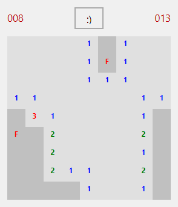

# Minesweeper on forms

Windows' Minesweeper, the beginner's field, written the way a VB6 developer would write it:
- `Form_Load` loads the field's 81 Labels with `Load` at run time and lays them out in twips;
- a right-click flags a cell, from `MouseDown` with `Button = vbRightButton`, and the count of mines left goes down;
- a left click digs it. The first dig lays the mines, so it is never one, and a cell with no mine round it digs its
  neighbours, recursively: a flood fill over a 2-D array;
- a Timer counts the seconds from the first dig;
- the face button starts again. A mine ends the game with `MsgBox`, and so does clearing the field.

## Files

| File | What it is |
|---|---|
| `MinesweeperForms.vbp` | The project. It starts at the form. |
| `frmMines.frm` | The game: the field, the mines-left count, the clock and the face. |

## Running it

- **In HexIDE:** open `MinesweeperForms.vbp` and press F5.
- **In VB6:** `VB6.EXE /make MinesweeperForms.vbp`. It builds cleanly, native and p-code.

## What it took

Nothing, as briefed: it ran under F5 the first time, a game won and a game lost. Battleship had already brought what
a game on a Label grid needs, and the rest (`MouseDown`'s Button, the Timer, recursion, 2-D arrays) was there.

So it grew what a real Minesweeper has: a Game menu with New on F2, and Beginner, Intermediate and Expert as a menu
control array, the level ticked with `mnuLevel(i).Checked = (i = Index)`. Each level resizes the field with `Load` and
`Unload` and fits the form to it. That version builds and plays in vb6.exe, Expert's 16 x 30 field included, and found
three things HexIDE gets wrong, each measured on vb6.exe:
- **The form fits itself with `Height = (Height - ScaleHeight) + needed`,** and on a form with a menu bar, ScaleHeight
  stops the run. The bar sits inside the client area here, so the bottom of the form is also cut off by its height
  (#1127).
- **`mnuLevel(i).Checked`** is "Variable not defined": no menu can be used from code at run time. Choosing a level
  calls `mnuLevel_Click` without its Index (#1126).
- **The automation tree names the menu `&Game`,** VB6's access-key marker included (#1128).

The menu waits for those, and the version with it is commit caab5bdd.

It also met three things already filed:
- **The cells' `BorderStyle = 1`** draws no border, so the field is one grey block where VB6 draws a grid of sunken
  cells (#1077).
- **No Label on a running form is in the automation tree,** so the field is played by clicking points on the form
  (#1076).
- **Under a dark theme the running form draws dark** (#806, #909).

Left out, because the interpreter doesn't have them yet: a best-times table, which wants `SaveSetting` and
`GetSetting` or file I/O.
