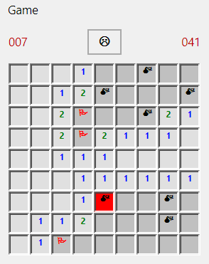

# Minesweeper on forms

Windows' Minesweeper, written the way a VB6 developer would write it:
- `Form_Load` loads the field's Labels with `Load` at run time and lays them out in twips, a grid of sunken cells;
- a right-click flags a cell, from `MouseDown` with `Button = vbRightButton`, and the count of mines left goes down;
- a left click digs it. The first dig lays the mines, so it is never one, and a cell with no mine round it digs its
  neighbours, recursively: a flood fill over a 2-D array;
- a middle click on a number whose mines are all flagged digs the cells round it;
- a Timer counts the seconds from the first dig, and the face holds its breath while a button is down;
- the Game menu has New on F2, and Beginner, Intermediate and Expert as a menu control array. Choosing a level ticks
  it, with `mnuLevel(i).Checked = (i = Index)`, resizes the field with `Load` and `Unload`, and fits the form to it;
- the flag, the mines and the faces are Wingdings, which the program switches to at run time with `FontName`;
- a mine ends the game with `MsgBox` and shows where the others were, and so does clearing the field.

## Files

| File | What it is |
|---|---|
| `MinesweeperForms.vbp` | The project. It starts at the form. |
| `frmMines.frm` | The game: the field, the mines-left count, the clock, the face and the Game menu. |

## Running it

- **In HexIDE:** open `MinesweeperForms.vbp` and press F5.
- **In VB6:** `VB6.EXE /make MinesweeperForms.vbp`. It builds cleanly, native and p-code.

**On a machine without Wingdings,** which is any Linux or macOS machine unless you install it, the game draws a flag
as `F`, a mine as `*`, and the faces as `:)`, `:o` and `:(`. It finds out the VB6 way: setting `FontName` to a font
the machine doesn't have raises 380, "Invalid property value", and `Form_Load` traps it. vb6.exe does the same on a
Windows machine without the font.

## What it took

The first version needed nothing new: it ran under F5 the first time, a game won and a game lost. Battleship had
already brought what a game on a Label grid needs, and the rest (`MouseDown`'s Button, the Timer, recursion, 2-D
arrays) was there.

Then it grew what a real Minesweeper has, and the game in this folder is that version. It runs in vb6.exe, and getting
it to run the same in HexIDE took six fixes, each measured on vb6.exe first:
- **The menu bar sat inside the client area** (#1127), so the bottom of the form was cut off by the bar's height, and
  reading `ScaleHeight` to fit the form to the field stopped the run.
- **No menu could be used from code** (#1126): `mnuLevel(i).Checked` was "Variable not defined", and choosing a level
  called `mnuLevel_Click` without its Index.
- **The cells' `BorderStyle = 1` drew no border** (#1077), so the field was one grey block where VB6 draws a grid of
  sunken cells.
- **Every font drew in one sans serif** (#1132): the family a form named was looked up only in a bundled collection
  that holds no fonts.
- **A Wingdings caption drew its letters** (#1133): `P` is a flag only once it is drawn at U+F050, where GDI maps a
  symbol font's characters.
- **`FontName` couldn't be set at run time** (#1141), and how vb6.exe answers it decided how the game falls back.

It also met three things still open:
- **The automation tree names the menu `&Game`,** VB6's access-key marker included (#1128).
- **No Label on a running form is in the automation tree,** so the field is played by clicking points on the form
  (#1076).
- **Under a dark theme the running form draws dark** (#806, #909).

Left out, because the interpreter doesn't have them yet: a best-times table, which wants `SaveSetting` and
`GetSetting` or file I/O.
