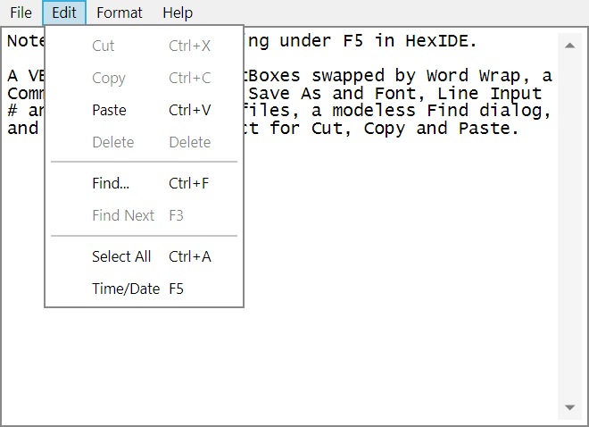

# Notepad on forms

Windows' Notepad, as it was in Windows 98 and XP, written the way a VB6 developer would write it:
- a multi-line TextBox fills the window and follows it as it resizes;
- **Word Wrap** swaps two TextBoxes, because MultiLine and ScrollBars can't be changed at run time: `txtEdit(0)` has
  a horizontal scroll bar, so it never wraps, and `txtEdit(1)` has none, so it always does;
- File, Edit, Format and Help menus, with Notepad's shortcuts: Ctrl+N, Ctrl+O, Ctrl+S, Ctrl+X, Ctrl+C, Ctrl+V, Del,
  Ctrl+F, F3, Ctrl+A and F5 for the time and date;
- a CommonDialog for Open, Save As and Font, with `CancelError` to tell Cancel from OK;
- files read with `Open ... For Input`, `Line Input #` and `EOF`, and written with `Open ... For Output` and
  `Print #`, each on a number from `FreeFile`;
- a modeless Find dialog owned by the main window, with Match case and a direction, and F3 to find again;
- Cut, Copy and Paste through the `Clipboard` object;
- a "save the changes?" prompt in `QueryUnload`, which closing, New and Open all go through;
- the file named on the command line, opened as Notepad opens it.

## Files

| File | What it is |
|---|---|
| `NotepadForms.vbp` | The project. It starts at `frmNotepad`, and references the CommonDialog control, `COMDLG32.OCX`. |
| `frmNotepad.frm` | The editor: the two TextBoxes, the menus, the dialogs, and the file I/O. |
| `frmFind.frm` | The Find dialog. |

## Running it

- **In VB6:** `VB6.EXE /make NotepadForms.vbp`. It builds cleanly, native and p-code. The p-code build opens a file
  from its command line, finds a word with the Find dialog, wraps a long line, asks to save when it is closed, and
  saves without adding a line ending the text didn't have.
- **In HexIDE:** open `NotepadForms.vbp` and press F5. Open, Save and Font show the IDE's own dialogs, which an
  automation client answers with `answer_next_file_dialog` and `interact`.

## What it took

Written the natural way, it ran into these, each measured on vb6.exe, native and p-code, and fixed:
- **The CommonDialog** refused the whole form (#1084). Open, Save As and Font now run.
- **`Open`, `Line Input #`, `Print #`, `Close`, `FreeFile` and `EOF`** stopped the run (#1145).
- **`Command$`, and `Left$` in a form's code,** stopped `Form_Load` (#742).
- **`SelStart`, `SelLength` and `SelText`** raised 438, so Find couldn't select what it found (#1150).
- **A form's `WindowState`,** which `Form_Resize` reads first, stopped the run (#1152).
- **The `Clipboard` object** was missing (#1156).
- **`MultiLine` and `ScrollBars`** weren't applied, so Enter added nothing and Word Wrap changed nothing (#1340).
- **Font sizes** drew as pixels rather than points, a quarter too small (#910).
- **`FontSize`, `FontBold` and `FontItalic`,** and a TextBox's own Font, stopped Format > Font at its first line
  (#1343, #915).
- **The Edit menu's own Click,** which enables Cut, Copy, Delete and Paste to match the selection and the clipboard,
  never ran: VB6 raises a menu's Click as it opens (#1344).

It found these, which it doesn't depend on:
- **`Clipboard.SetText` is refused** when the clipboard holds anything besides text (#1246). Cut and Copy call
  `Clipboard.Clear` first, as VB6 programs usually do, so they never meet it.
- **The Find dialog's one-line TextBox** clips the bottom of its text (#914).

And these, which still show in it:
- **`SelStart` after Select All, Ctrl+End and a paste** reads where the paste went in, not the caret after it, so Find
  Up then starts from the middle of the text (#1385).
- **Under a dark IDE theme the TextBoxes and the menu bar draw dark,** where VB6's follow the system's window colours
  (#806, #909).

## Left out

**Undo.** Notepad's Undo is the edit control's own, and a VB6 program reaches it by sending the TextBox an
`EM_UNDO` message through a declared Win32 function, `SendMessage`. HexIDE doesn't call the Windows API, by design,
because it runs where there is no Windows API to call. An Undo written in VB6 itself would need the program to keep
its own history of the text, which no VB6 Notepad clone does, so the menu leaves it out instead.

**Print and Page Setup.** They need the `Printer` object, which HexIDE doesn't have.
